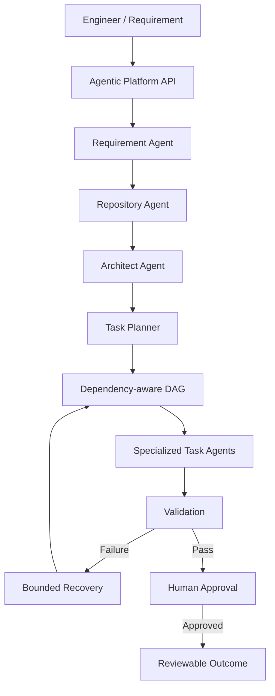

# Agentic Software Engineering System

[](https://github.com/<YOUR_GITHUB_USERNAME>/<YOUR_REPOSITORY>/actions/workflows/ci.yml)

A Python prototype demonstrating how a software requirement can be normalized, decomposed into dependent engineering tasks, executed through coordinated agents, validated, and routed through a human approval gate.

> **Scope transparency:** The current orchestration agents are deterministic demonstration implementations. They demonstrate workflow contracts, dependency-aware concurrency, error states, recovery flow and approval controls. They do not yet use an LLM to generate or modify source code. The URL shortener is a separate runnable reference application. See [Known limitations](#known-limitations).

## Features

- Requirement classification and ambiguity detection
- Greenfield and lightweight brownfield repository inventory
- Architecture and task-plan generation
- Dependency-aware DAG scheduling with concurrent ready tasks
- Validation and bounded recovery demonstration
- Human approval endpoint
- Runnable FastAPI URL shortener with persistence, aliases, redirects, expiry and click counts
- Mermaid architecture and workflow diagrams
- Automated tests and GitHub Actions CI

## Architecture



More diagrams are available in [`diagrams/`](diagrams/).

## Quick start

### 1. Requirements
- Python 3.11+
- pip

### 2. Clone and install
```bash
git clone https://github.com/<YOUR_GITHUB_USERNAME>/<YOUR_REPOSITORY>.git
cd <YOUR_REPOSITORY>

python -m venv .venv
# Windows PowerShell:
.venv\\Scripts\\Activate.ps1
# macOS/Linux:
source .venv/bin/activate

python -m pip install --upgrade pip
pip install -e ".[dev]"
```

### 3. Run the agentic platform
```bash
uvicorn platform_api.main:app --reload --port 8000
```
- Swagger UI: http://127.0.0.1:8000/docs
- Health check: http://127.0.0.1:8000/health

Submit the mandatory URL-shortener requirement:
```bash
curl -X POST http://127.0.0.1:8000/workflows \\
  -H "Content-Type: application/json" \\
  -d '{"requirement":"Build a scalable URL shortener service with APIs, persistence, and analytics.","scenario":"greenfield","inject_failure_once":true}'
```
The response includes the workflow ID, task graph, execution events, validation and recovery details. A successful workflow pauses at `NEEDS_APPROVAL`.

Approve only after reviewing the result:
```bash
curl -X POST http://127.0.0.1:8000/workflows/<workflow_id>/approve
```

### 4. Run the URL shortener reference application
In another terminal:
```bash
uvicorn url_shortener.main:app --reload --port 8001
```
Create a URL:
```bash
curl -X POST http://127.0.0.1:8001/api/v1/urls \\
  -H "Content-Type: application/json" \\
  -d '{"original_url":"https://example.com/docs","custom_alias":"docs-home"}'
```
- Redirect: `GET http://127.0.0.1:8001/docs-home`
- Analytics: `GET http://127.0.0.1:8001/api/v1/urls/docs-home/analytics`

Optional configuration:
```bash
cp .env.example .env
```
Set `SHORTENER_PUBLIC_BASE_URL` and, if required, `SHORTENER_DB_PATH`.

### 5. Run both services with Docker Compose
```bash
docker compose up --build
```
- Agentic platform: http://localhost:8000/docs
- URL shortener: http://localhost:8001/docs

The URL shortener database is stored in a named Docker volume.

## Example scenarios

| Scenario | Input | Expected behavior |
|---|---|---|
| Greenfield | Build a scalable URL shortener... | Requirement normalization, architecture and DAG |
| Brownfield | Add custom aliases to existing URL service | Repository inventory and impact hints |
| Ambiguous | Make the service faster and improve analytics | Clarification questions and pause |
| Recovery | Set `inject_failure_once=true` | Simulated validation failure and bounded retry |

For complete request examples see [`docs/API_EXAMPLES.md`](docs/API_EXAMPLES.md).

## Tests and quality checks

```bash
python -m compileall -q platform_api url_shortener tests
pytest -q
ruff check .
ruff format --check .
```

The CI workflow runs compilation and automated tests on pushes and pull requests. See [`VERIFICATION.md`](VERIFICATION.md) for the latest local verification record.

## Repository layout

```text
.
├── .github/
│   ├── ISSUE_TEMPLATE/
│   └── workflows/           # CI
├── artifacts/                # Sample requirement, task plan and design notes
├── diagrams/                 # Mermaid architecture and flow diagrams
├── docs/                     # API examples and repository guide
├── platform_api/             # Agentic workflow API and orchestration
├── tests/                    # Platform and URL-shortener tests
├── url_shortener/            # Runnable reference URL-shortener application
├── Dockerfile
├── docker-compose.yml
├── pyproject.toml
└── README.md
```

## Error handling and safety

- Request validation errors return HTTP 422.
- Duplicate custom aliases return HTTP 409.
- Unknown short codes return HTTP 404; expired codes return HTTP 410.
- Persistence availability errors return HTTP 503.
- Workflow failures are recorded with event details; downstream tasks are blocked after task failures.
- Retries are bounded. Security/policy failures should be escalated, not blindly retried.
- Human approval is required before the workflow is marked approved.
- The prototype does not merge code or deploy workloads.

## Known limitations

This is an interview/demo prototype, not a production-ready autonomous software engineering platform:
- Agent task outputs are deterministic placeholders; no live LLM code generation is wired in.
- Brownfield analysis is a lightweight file inventory and keyword heuristic, not AST or semantic dependency analysis.
- Workflow state is held in process memory and is lost on restart.
- URL shortener analytics are synchronous counters; production should use a durable event queue and idempotent consumers.
- SQLite is for local demonstration; production should use PostgreSQL or another managed datastore.
- Authentication, authorization, rate limiting, abuse controls, distributed workers, sandboxed code execution and production observability remain future work.

## Production hardening roadmap

1. Add schema-constrained LLM adapters with model/version tracking, token budgets and prompt redaction.
2. Persist workflow/task state and checkpoints in PostgreSQL.
3. Use Temporal, AWS Step Functions or a durable queue for distributed execution.
4. Run generated code in ephemeral sandbox containers with strict resource and network limits.
5. Add OIDC/RBAC, secrets management, policy-as-code and immutable audit events.
6. Add AST-based repository indexing, dependency graphs and test-impact analysis.
7. Add load, chaos, threat-model, backup/restore and supply-chain security testing.

## Documentation

- [Repository guide](docs/REPOSITORY_GUIDE.md)
- [API examples](docs/API_EXAMPLES.md)
- [Verification report](VERIFICATION.md)
- [Contributing](CONTRIBUTING.md)
- [Security policy](SECURITY.md)
